# Low Level Design: Home Automation DXL Backend (HA_dxl_backend)

## 1. Document Control

- **Version:** 1.0 (Draft for Review)
- **Source:** User Stories US-001, US-002, US-003, US-004, US-005, US-006, US-007, US-008, US-009, US-010, US-011, US-012
- **Tech Stack:** React 18+ (TypeScript) | Java 21 + Spring Boot 3.x | PostgreSQL 15+
- **Date:** 2025-07-10
- **Author:** Senior Java Spring Boot Solution Architect

---

## 2. Overview

### Purpose and Scope

The HA DXL Backend is an enterprise-grade Home Automation Device Experience Layer (DXL) platform that enables administrators and end-users to manage smart home devices, automate routines, monitor device telemetry, and control access through a role-based security model. The system exposes a RESTful API consumed by a React TypeScript single-page application. It is designed as a modular monolith with a layered architecture to ensure maintainability, scalability, and compliance with enterprise security standards.

### Actors / Roles

| Role | Description |
|------|-------------|
| **ADMIN** | Platform administrator; manages users, devices, rooms, and system configuration |
| **USER** | Authenticated homeowner; controls own devices, creates automations, views telemetry |
| **GUEST** | Limited read-only access to shared devices (view status only) |
| **SYSTEM** | Internal service account used for scheduled jobs and telemetry ingestion |

### Out of Scope / Deferred

- Third-party voice assistant integrations (Alexa, Google Home)
- Real-time WebSocket/MQTT device push (deferred; polling assumed for MVP)
- Multi-tenancy / multi-home support beyond single household
- Mobile native applications (iOS/Android)
- Billing and subscription management
- Machine learning-based automation suggestions
- External OAuth2/Social login providers
- Device firmware OTA update management

---

## 3. Assumptions and Open Questions

| ID | Type | Description | Impact | Related US |
|----|------|-------------|--------|------------|
| A-01 | Assumption | A single household model is used; all users belong to one home instance per deployment | Simplifies data model; no tenant isolation needed | US-001, US-002 |
| A-02 | Assumption | Authentication uses stateless JWT (access token 15 min, refresh token 7 days) stored in HttpOnly cookies | Security posture; CSRF protection required | US-001 |
| A-03 | Assumption | Device telemetry is ingested via REST POST from device agents (no MQTT broker in scope) | No message queue needed for MVP | US-007, US-008 |
| A-04 | Assumption | Password policy (design default): minimum 8 characters, at least 1 uppercase, 1 digit, 1 special character | Security compliance | US-001 |
| A-05 | Assumption | Default pagination page size is 20 records (design default) | API consistency | All list endpoints |
| A-06 | Assumption | Devices have a fixed set of supported types defined as an enum (LIGHT, THERMOSTAT, LOCK, SENSOR, SWITCH, CAMERA) | Limits scope to known device categories | US-003, US-004 |
| A-07 | Assumption | Automation rules support simple trigger-action pairs (one trigger → one or more actions); complex CEP is out of scope | Keeps rule engine simple | US-009, US-010 |
| A-08 | Assumption | Telemetry data is retained for 90 days (design default); older records are purged by a scheduled job | Storage management | US-007, US-008 |
| A-09 | Assumption | GUEST role is assigned by ADMIN; guests cannot modify devices or create automations | Role clarity | US-002, US-005 |
| A-10 | Assumption | All timestamps are stored in UTC; frontend converts to local timezone for display | Data consistency | All entities |
| A-11 | Assumption | Optimistic locking is applied to Device and AutomationRule entities to prevent concurrent update conflicts | Data integrity | US-004, US-010 |
| A-12 | Assumption | The React frontend is served as a static SPA; the Spring Boot app serves only REST API endpoints | Deployment clarity | All US |
| Q-01 | Open Question | Should GUEST users receive real-time notifications when a shared device state changes? | May require WebSocket addition | US-005 |
| Q-02 | Open Question | Is there a maximum number of devices per room or automations per user? | Affects validation rules | US-003, US-009 |
| Q-03 | Open Question | Should telemetry ingestion require device-level API keys separate from user JWTs? | Security model for IoT agents | US-007 |
| Q-04 | Open Question | What is the required SLA for device command execution latency? | May require async processing | US-006 |
| Q-05 | Open Question | Should audit logs be exportable (CSV/PDF) by ADMIN? | Adds export API | US-011 |

---

## 4. Architecture Overview

### Layered Architecture Description

The system follows a strict **4-layer modular monolith** architecture:

1. **Presentation Layer** – React 18 TypeScript SPA; communicates via Axios over HTTPS to the REST API.
2. **API Layer** – Spring Boot REST Controllers; handles HTTP concerns, request validation, and response mapping only.
3. **Service Layer** – Business logic, transaction boundaries, orchestration between repositories.
4. **Data Layer** – Spring Data JPA Repositories, Flyway-managed PostgreSQL schema.

Cross-cutting concerns (security, logging, error handling, auditing) are handled via Spring AOP, filters, and `@RestControllerAdvice`.

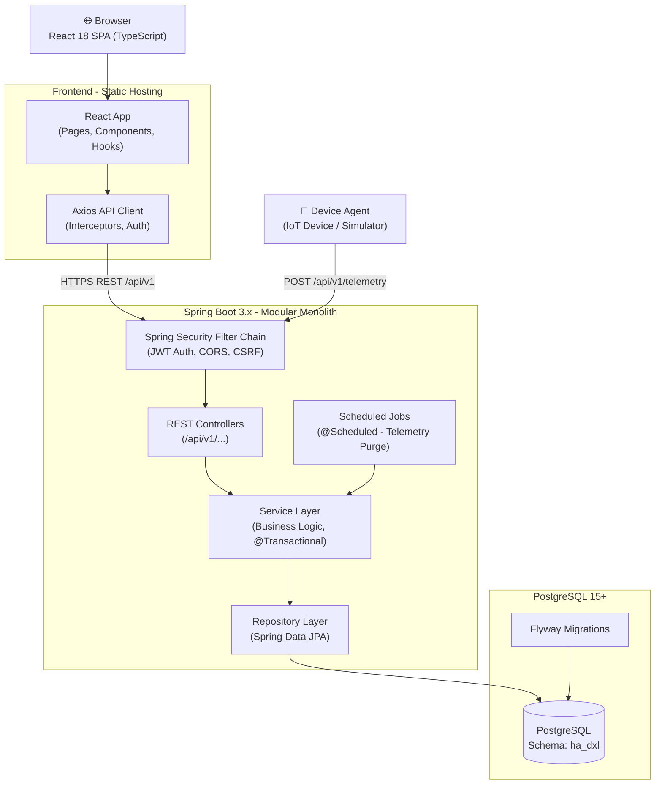

### Key Design Decisions

| Decision | Rationale | Alternatives Rejected |
|----------|-----------|-----------------------|
| Modular Monolith over Microservices | No story requires independent deployment or scaling of individual features; reduces operational complexity | Microservices (over-engineered for scope) |
| Stateless JWT in HttpOnly Cookies | Prevents XSS token theft; stateless scales horizontally; 15-min access token limits blast radius | Session-based auth (requires sticky sessions), localStorage JWT (XSS risk) |
| Spring Data JPA with Hibernate | Reduces boilerplate, integrates with Spring ecosystem, supports optimistic locking natively | JOOQ (more verbose for this scope), MyBatis |
| MapStruct for DTO mapping | Compile-time, type-safe, zero-reflection mapping; no business logic leakage | ModelMapper (reflection-based, slower), manual mapping (error-prone) |
| Flyway for DB migrations | Version-controlled, repeatable migrations; integrates with Spring Boot auto-run on startup | Liquibase (XML-heavy), manual DDL |
| React Hook Form + Zod | Performant uncontrolled forms; Zod mirrors backend Bean Validation schemas in TypeScript | Formik (heavier), Yup (less type-safe) |
| Repository Pattern | Decouples data access from business logic; enables easy testing with mocks | Active Record (couples domain to persistence) |
| Strategy Pattern for Automation Triggers | Extensible trigger evaluation without modifying existing code | Switch-case in service (violates OCP) |

---

## 5. Data Design

### 5.1 ER Diagram

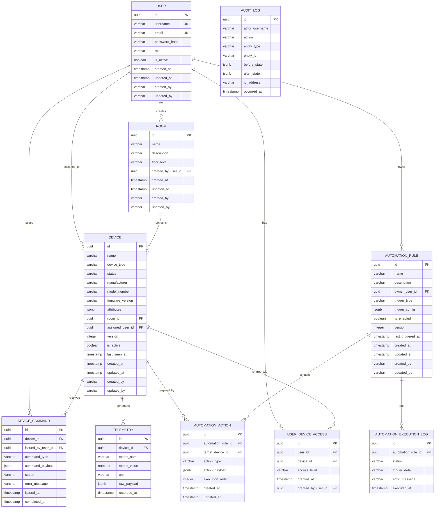

### 5.2 Table Specifications

#### Table: `users`

**Purpose:** Stores authenticated platform users with role-based access.

| Column | PostgreSQL Type | Nullable | Default | Constraints |
|--------|----------------|----------|---------|-------------|
| id | UUID | NOT NULL | gen_random_uuid() | PK |
| username | VARCHAR(50) | NOT NULL | — | UNIQUE, CHECK length >= 3 |
| email | VARCHAR(255) | NOT NULL | — | UNIQUE, valid email format |
| password_hash | VARCHAR(255) | NOT NULL | — | — |
| role | VARCHAR(20) | NOT NULL | 'USER' | CHECK IN ('ADMIN','USER','GUEST') |
| is_active | BOOLEAN | NOT NULL | TRUE | — |
| created_at | TIMESTAMPTZ | NOT NULL | NOW() | — |
| updated_at | TIMESTAMPTZ | NOT NULL | NOW() | — |
| created_by | VARCHAR(100) | NOT NULL | — | — |
| updated_by | VARCHAR(100) | NOT NULL | — | — |

- **PK:** id
- **Unique:** username, email
- **Indexes:** idx_users_email (email), idx_users_username (username), idx_users_role (role)
- **Audit:** created_at, updated_at, created_by, updated_by

#### Table: `rooms`

**Purpose:** Logical grouping of devices within the home.

| Column | PostgreSQL Type | Nullable | Default | Constraints |
|--------|----------------|----------|---------|-------------|
| id | UUID | NOT NULL | gen_random_uuid() | PK |
| name | VARCHAR(100) | NOT NULL | — | UNIQUE |
| description | VARCHAR(500) | YES | NULL | — |
| floor_level | VARCHAR(50) | YES | NULL | — |
| created_by_user_id | UUID | NOT NULL | — | FK → users(id) |
| created_at | TIMESTAMPTZ | NOT NULL | NOW() | — |
| updated_at | TIMESTAMPTZ | NOT NULL | NOW() | — |
| created_by | VARCHAR(100) | NOT NULL | — | — |
| updated_by | VARCHAR(100) | NOT NULL | — | — |

- **PK:** id
- **FK:** created_by_user_id → users(id) ON DELETE RESTRICT
- **Unique:** name
- **Indexes:** idx_rooms_name (name)

#### Table: `devices`

**Purpose:** Registered smart home devices with state and metadata.

| Column | PostgreSQL Type | Nullable | Default | Constraints |
|--------|----------------|----------|---------|-------------|
| id | UUID | NOT NULL | gen_random_uuid() | PK |
| name | VARCHAR(100) | NOT NULL | — | — |
| device_type | VARCHAR(30) | NOT NULL | — | CHECK IN ('LIGHT','THERMOSTAT','LOCK','SENSOR','SWITCH','CAMERA') |
| status | VARCHAR(20) | NOT NULL | 'OFFLINE' | CHECK IN ('ONLINE','OFFLINE','ERROR','MAINTENANCE') |
| manufacturer | VARCHAR(100) | YES | NULL | — |
| model_number | VARCHAR(100) | YES | NULL | — |
| firmware_version | VARCHAR(50) | YES | NULL | — |
| attributes | JSONB | YES | '{}' | — |
| room_id | UUID | YES | NULL | FK → rooms(id) |
| assigned_user_id | UUID | YES | NULL | FK → users(id) |
| version | INTEGER | NOT NULL | 0 | Optimistic lock |
| is_active | BOOLEAN | NOT NULL | TRUE | — |
| last_seen_at | TIMESTAMPTZ | YES | NULL | — |
| created_at | TIMESTAMPTZ | NOT NULL | NOW() | — |
| updated_at | TIMESTAMPTZ | NOT NULL | NOW() | — |
| created_by | VARCHAR(100) | NOT NULL | — | — |
| updated_by | VARCHAR(100) | NOT NULL | — | — |

- **PK:** id
- **FK:** room_id → rooms(id) ON DELETE SET NULL; assigned_user_id → users(id) ON DELETE SET NULL
- **Indexes:** idx_devices_room_id (room_id), idx_devices_status (status), idx_devices_type (device_type), idx_devices_assigned_user (assigned_user_id), idx_devices_is_active (is_active)
- **Optimistic Locking:** version column managed by Hibernate @Version

#### Table: `device_commands`

**Purpose:** Audit trail and execution log of commands sent to devices.

| Column | PostgreSQL Type | Nullable | Default | Constraints |
|--------|----------------|----------|---------|-------------|
| id | UUID | NOT NULL | gen_random_uuid() | PK |
| device_id | UUID | NOT NULL | — | FK → devices(id) |
| issued_by_user_id | UUID | NOT NULL | — | FK → users(id) |
| command_type | VARCHAR(50) | NOT NULL | — | CHECK IN ('TURN_ON','TURN_OFF','SET_TEMPERATURE','LOCK','UNLOCK','SET_BRIGHTNESS','SET_COLOR') |
| command_payload | JSONB | YES | '{}' | — |
| status | VARCHAR(20) | NOT NULL | 'PENDING' | CHECK IN ('PENDING','SENT','ACKNOWLEDGED','FAILED') |
| error_message | VARCHAR(500) | YES | NULL | — |
| issued_at | TIMESTAMPTZ | NOT NULL | NOW() | — |
| completed_at | TIMESTAMPTZ | YES | NULL | — |

- **PK:** id
- **FK:** device_id → devices(id) ON DELETE CASCADE; issued_by_user_id → users(id) ON DELETE RESTRICT
- **Indexes:** idx_device_commands_device_id (device_id), idx_device_commands_issued_at (issued_at DESC), idx_device_commands_status (status)

#### Table: `telemetry`

**Purpose:** Time-series device sensor readings and state snapshots.

| Column | PostgreSQL Type | Nullable | Default | Constraints |
|--------|----------------|----------|---------|-------------|
| id | UUID | NOT NULL | gen_random_uuid() | PK |
| device_id | UUID | NOT NULL | — | FK → devices(id) |
| metric_name | VARCHAR(100) | NOT NULL | — | — |
| metric_value | NUMERIC(15,4) | NOT NULL | — | — |
| unit | VARCHAR(30) | YES | NULL | — |
| raw_payload | JSONB | YES | NULL | — |
| recorded_at | TIMESTAMPTZ | NOT NULL | NOW() | — |

- **PK:** id
- **FK:** device_id → devices(id) ON DELETE CASCADE
- **Indexes:** idx_telemetry_device_recorded (device_id, recorded_at DESC), idx_telemetry_recorded_at (recorded_at DESC)
- **Retention:** Records older than 90 days purged by scheduled job (design default)

#### Table: `automation_rules`

**Purpose:** User-defined automation rules with trigger and action configuration.

| Column | PostgreSQL Type | Nullable | Default | Constraints |
|--------|----------------|----------|---------|-------------|
| id | UUID | NOT NULL | gen_random_uuid() | PK |
| name | VARCHAR(100) | NOT NULL | — | — |
| description | VARCHAR(500) | YES | NULL | — |
| owner_user_id | UUID | NOT NULL | — | FK → users(id) |
| trigger_type | VARCHAR(50) | NOT NULL | — | CHECK IN ('SCHEDULE','DEVICE_STATE','SUNRISE','SUNSET','MANUAL') |
| trigger_config | JSONB | NOT NULL | '{}' | — |
| is_enabled | BOOLEAN | NOT NULL | TRUE | — |
| version | INTEGER | NOT NULL | 0 | Optimistic lock |
| last_triggered_at | TIMESTAMPTZ | YES | NULL | — |
| created_at | TIMESTAMPTZ | NOT NULL | NOW() | — |
| updated_at | TIMESTAMPTZ | NOT NULL | NOW() | — |
| created_by | VARCHAR(100) | NOT NULL | — | — |
| updated_by | VARCHAR(100) | NOT NULL | — | — |

- **PK:** id
- **FK:** owner_user_id → users(id) ON DELETE CASCADE
- **Indexes:** idx_automation_rules_owner (owner_user_id), idx_automation_rules_enabled (is_enabled), idx_automation_rules_trigger_type (trigger_type)
- **Optimistic Locking:** version column

#### Table: `automation_actions`

**Purpose:** Individual actions executed as part of an automation rule.

| Column | PostgreSQL Type | Nullable | Default | Constraints |
|--------|----------------|----------|---------|-------------|
| id | UUID | NOT NULL | gen_random_uuid() | PK |
| automation_rule_id | UUID | NOT NULL | — | FK → automation_rules(id) |
| target_device_id | UUID | NOT NULL | — | FK → devices(id) |
| action_type | VARCHAR(50) | NOT NULL | — | CHECK IN ('TURN_ON','TURN_OFF','SET_TEMPERATURE','LOCK','UNLOCK','SET_BRIGHTNESS','SET_COLOR') |
| action_payload | JSONB | YES | '{}' | — |
| execution_order | INTEGER | NOT NULL | 1 | CHECK >= 1 |
| created_at | TIMESTAMPTZ | NOT NULL | NOW() | — |
| updated_at | TIMESTAMPTZ | NOT NULL | NOW() | — |

- **PK:** id
- **FK:** automation_rule_id → automation_rules(id) ON DELETE CASCADE; target_device_id → devices(id) ON DELETE RESTRICT
- **Indexes:** idx_automation_actions_rule_id (automation_rule_id)

#### Table: `automation_execution_logs`

**Purpose:** Records each execution attempt of an automation rule.

| Column | PostgreSQL Type | Nullable | Default | Constraints |
|--------|----------------|----------|---------|-------------|
| id | UUID | NOT NULL | gen_random_uuid() | PK |
| automation_rule_id | UUID | NOT NULL | — | FK → automation_rules(id) |
| status | VARCHAR(20) | NOT NULL | — | CHECK IN ('SUCCESS','PARTIAL_FAILURE','FAILURE') |
| trigger_detail | VARCHAR(500) | YES | NULL | — |
| error_message | VARCHAR(1000) | YES | NULL | — |
| executed_at | TIMESTAMPTZ | NOT NULL | NOW() | — |

- **PK:** id
- **FK:** automation_rule_id → automation_rules(id) ON DELETE CASCADE
- **Indexes:** idx_automation_exec_logs_rule_id (automation_rule_id), idx_automation_exec_logs_executed_at (executed_at DESC)

#### Table: `audit_logs`

**Purpose:** Immutable audit trail of all significant system actions.

| Column | PostgreSQL Type | Nullable | Default | Constraints |
|--------|----------------|----------|---------|-------------|
| id | UUID | NOT NULL | gen_random_uuid() | PK |
| actor_username | VARCHAR(100) | NOT NULL | — | — |
| action | VARCHAR(100) | NOT NULL | — | — |
| entity_type | VARCHAR(100) | NOT NULL | — | — |
| entity_id | VARCHAR(100) | NOT NULL | — | — |
| before_state | JSONB | YES | NULL | — |
| after_state | JSONB | YES | NULL | — |
| ip_address | VARCHAR(45) | YES | NULL | — |
| occurred_at | TIMESTAMPTZ | NOT NULL | NOW() | — |

- **PK:** id
- **No FK constraints** (audit logs must survive entity deletion)
- **Indexes:** idx_audit_logs_actor (actor_username), idx_audit_logs_entity (entity_type, entity_id), idx_audit_logs_occurred_at (occurred_at DESC)

#### Table: `user_device_access`

**Purpose:** Grants GUEST users access to specific devices.

| Column | PostgreSQL Type | Nullable | Default | Constraints |
|--------|----------------|----------|---------|-------------|
| id | UUID | NOT NULL | gen_random_uuid() | PK |
| user_id | UUID | NOT NULL | — | FK → users(id) |
| device_id | UUID | NOT NULL | — | FK → devices(id) |
| access_level | VARCHAR(20) | NOT NULL | 'READ' | CHECK IN ('READ','CONTROL') |
| granted_at | TIMESTAMPTZ | NOT NULL | NOW() | — |
| granted_by_user_id | UUID | NOT NULL | — | FK → users(id) |

- **PK:** id
- **FK:** user_id → users(id) ON DELETE CASCADE; device_id → devices(id) ON DELETE CASCADE; granted_by_user_id → users(id) ON DELETE RESTRICT
- **Unique:** (user_id, device_id)
- **Indexes:** idx_user_device_access_user (user_id), idx_user_device_access_device (device_id)

### 5.3 Reference / Enum Data and State Machines

#### Enumerations

| Enum | Values |
|------|--------|
| UserRole | ADMIN, USER, GUEST |
| DeviceType | LIGHT, THERMOSTAT, LOCK, SENSOR, SWITCH, CAMERA |
| DeviceStatus | ONLINE, OFFLINE, ERROR, MAINTENANCE |
| CommandType | TURN_ON, TURN_OFF, SET_TEMPERATURE, LOCK, UNLOCK, SET_BRIGHTNESS, SET_COLOR |
| CommandStatus | PENDING, SENT, ACKNOWLEDGED, FAILED |
| TriggerType | SCHEDULE, DEVICE_STATE, SUNRISE, SUNSET, MANUAL |
| ActionType | TURN_ON, TURN_OFF, SET_TEMPERATURE, LOCK, UNLOCK, SET_BRIGHTNESS, SET_COLOR |
| AutomationExecutionStatus | SUCCESS, PARTIAL_FAILURE, FAILURE |
| AccessLevel | READ, CONTROL |

#### Device Status State Machine

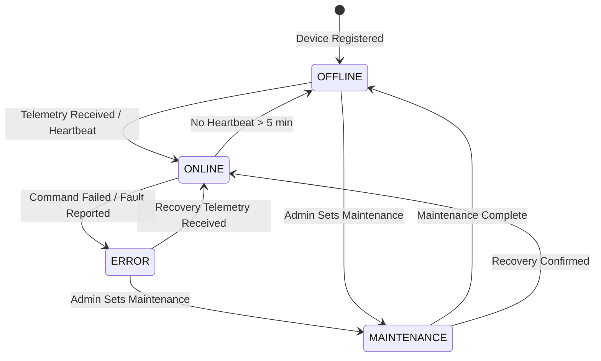

#### Command Status State Machine

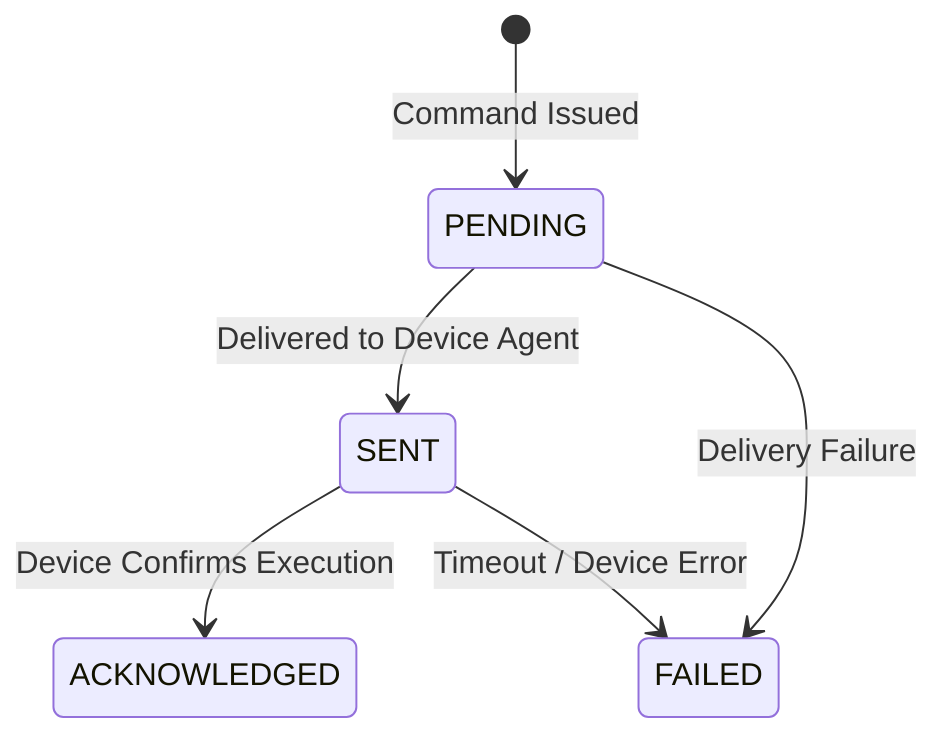

#### Automation Rule State Machine

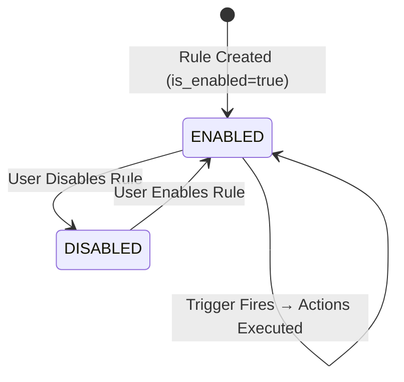

### 5.4 Migration Plan

| Script | Description | Order |
|--------|-------------|-------|
| V1__init_schema_users.sql | Create `users` table with indexes | 1 |
| V2__init_schema_rooms.sql | Create `rooms` table with FK to users | 2 |
| V3__init_schema_devices.sql | Create `devices` table with FKs to rooms and users | 3 |
| V4__init_schema_device_commands.sql | Create `device_commands` table | 4 |
| V5__init_schema_telemetry.sql | Create `telemetry` table | 5 |
| V6__init_schema_automation_rules.sql | Create `automation_rules` table | 6 |
| V7__init_schema_automation_actions.sql | Create `automation_actions` table | 7 |
| V8__init_schema_automation_execution_logs.sql | Create `automation_execution_logs` table | 8 |
| V9__init_schema_audit_logs.sql | Create `audit_logs` table | 9 |
| V10__init_schema_user_device_access.sql | Create `user_device_access` table | 10 |
| V11__seed_admin_user.sql | Insert default ADMIN user (hashed password via bcrypt placeholder) | 11 |
| V12__add_telemetry_partitioning.sql | Add range partitioning on `telemetry.recorded_at` by month (optional, deferred) | 12 |

All scripts reside in `src/main/resources/db/migration/`. Flyway runs automatically on Spring Boot startup (`spring.flyway.enabled=true`).

---

## 6. Backend Design

### 6.1 Package Structure

```
com.ha.dxl
├── HaDxlApplication.java
├── config
│   ├── SecurityConfig.java
│   ├── JwtConfig.java
│   ├── CorsConfig.java
│   ├── OpenApiConfig.java
│   ├── AuditConfig.java
│   └── SchedulerConfig.java
├── security
│   ├── JwtTokenProvider.java
│   ├── JwtAuthenticationFilter.java
│   ├── JwtAuthenticationEntryPoint.java
│   ├── CustomUserDetailsService.java
│   └── SecurityUtils.java
├── exception
│   ├── GlobalExceptionHandler.java
│   ├── ResourceNotFoundException.java
│   ├── BusinessRuleException.java
│   ├── ConflictException.java
│   ├── UnauthorizedException.java
│   └── ErrorResponse.java
├── common
│   ├── dto
│   │   ├── PagedResponse.java
│   │   └── ApiResponse.java
│   ├── audit
│   │   ├── AuditAware.java
│   │   └── AuditLogService.java
│   └── util
│       └── UuidUtils.java
├── user
│   ├── controller
│   │   └── UserController.java
│   ├── service
│   │   ├── UserService.java
│   │   └── impl
│   │       └── UserServiceImpl.java
│   ├── repository
│   │   └── UserRepository.java
│   ├── domain
│   │   └── User.java
│   ├── dto
│   │   ├── UserCreateRequest.java
│   │   ├── UserUpdateRequest.java
│   │   ├── UserResponse.java
│   │   └── ChangePasswordRequest.java
│   └── mapper
│       └── UserMapper.java
├── auth
│   ├── controller
│   │   └── AuthController.java
│   ├── service
│   │   ├── AuthService.java
│   │   └── impl
│   │       └── AuthServiceImpl.java
│   └── dto
│       ├── LoginRequest.java
│       ├── LoginResponse.java
│       └── RefreshTokenRequest.java
├── room
│   ├── controller
│   │   └── RoomController.java
│   ├── service
│   │   ├── RoomService.java
│   │   └── impl
│   │       └── RoomServiceImpl.java
│   ├── repository
│   │   └── RoomRepository.java
│   ├── domain
│   │   └── Room.java
│   ├── dto
│   │   ├── RoomCreateRequest.java
│   │   ├── RoomUpdateRequest.java
│   │   └── RoomResponse.java
│   └── mapper
│       └── RoomMapper.java
├── device
│   ├── controller
│   │   ├── DeviceController.java
│   │   └── DeviceCommandController.java
│   ├── service
│   │   ├── DeviceService.java
│   │   ├── DeviceCommandService.java
│   │   └── impl
│   │       ├── DeviceServiceImpl.java
│   │       └── DeviceCommandServiceImpl.java
│   ├── repository
│   │   ├── DeviceRepository.java
│   │   └── DeviceCommandRepository.java
│   ├── domain
│   │   ├── Device.java
│   │   └── DeviceCommand.java
│   ├── dto
│   │   ├── DeviceCreateRequest.java
│   │   ├── DeviceUpdateRequest.java
│   │   ├── DeviceResponse.java
│   │   ├── DeviceCommandRequest.java
│   │   └── DeviceCommandResponse.java
│   └── mapper
│       ├── DeviceMapper.java
│       └── DeviceCommandMapper.java
├── telemetry
│   ├── controller
│   │   └── TelemetryController.java
│   ├── service
│   │   ├── TelemetryService.java
│   │   └── impl
│   │       └── TelemetryServiceImpl.java
│   ├── repository
│   │   └── TelemetryRepository.java
│   ├── domain
│   │   └── Telemetry.java
│   ├── dto
│   │   ├── TelemetryIngestRequest.java
│   │   └── TelemetryResponse.java
│   └── mapper
│       └── TelemetryMapper.java
├── automation
│   ├── controller
│   │   └── AutomationRuleController.java
│   ├── service
│   │   ├── AutomationRuleService.java
│   │   ├── AutomationExecutionService.java
│   │   └── impl
│   │       ├── AutomationRuleServiceImpl.java
│   │       └── AutomationExecutionServiceImpl.java
│   ├── strategy
│   │   ├── TriggerEvaluator.java
│   │   ├── ScheduleTriggerEvaluator.java
│   │   ├── DeviceStateTriggerEvaluator.java
│   │   └── ManualTriggerEvaluator.java
│   ├── repository
│   │   ├── AutomationRuleRepository.java
│   │   ├── AutomationActionRepository.java
│   │   └── AutomationExecutionLogRepository.java
│   ├── domain
│   │   ├── AutomationRule.java
│   │   ├── AutomationAction.java
│   │   └── AutomationExecutionLog.java
│   ├── dto
│   │   ├── AutomationRuleCreateRequest.java
│   │   ├── AutomationRuleUpdateRequest.java
│   │   ├── AutomationRuleResponse.java
│   │   ├── AutomationActionRequest.java
│   │   └── AutomationExecutionLogResponse.java
│   └── mapper
│       └── AutomationRuleMapper.java
└── audit
    ├── controller
    │   └── AuditLogController.java
    ├── service
    │   ├── AuditLogService.java
    │   └── impl
    │       └── AuditLogServiceImpl.java
    ├── repository
    │   └── AuditLogRepository.java
    ├── domain
    │   └── AuditLog.java
    ├── dto
    │   └── AuditLogResponse.java
    └── mapper
        └── AuditLogMapper.java
```

### 6.2 Class Diagram

#### Module: Auth & User

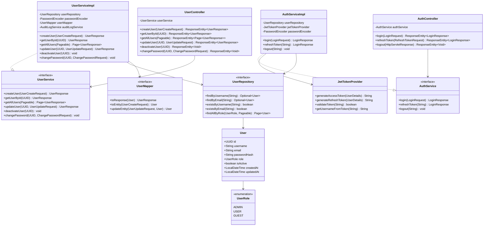

#### Module: Device & Room

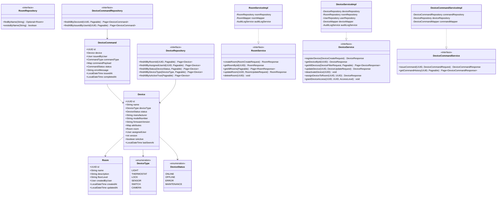

#### Module: Telemetry & Automation

```mermaid
classDiagram
    class Telemetry {
        +UUID id
        +Device device
        +String metricName
        +BigDecimal metricValue
        +String unit
        +Map rawPayload
        +LocalDateTime recordedAt
    }

    class AutomationRule {
        +UUID id
        +String name
        +String description
        +User ownerUser
        +TriggerType triggerType
        +Map triggerConfig
        +boolean isEnabled
        +int version
        +LocalDateTime lastTriggeredAt
        +List~AutomationAction~ actions
    }

    class AutomationAction {
        +UUID id
        +AutomationRule automationRule
        +Device targetDevice
        +ActionType actionType
        +Map actionPayload
        +int executionOrder
    }

    class AutomationExecutionLog {
        +UUID id
        +AutomationRule automationRule
        +ExecutionStatus status
        +String triggerDetail
        +String errorMessage
        +LocalDateTime executedAt
    }

    class TriggerEvaluator {
        <<interface>>
        +supports(TriggerType) boolean
        +evaluate(AutomationRule) boolean
    }

    class ScheduleTriggerEvaluator {
        +supports(TriggerType) boolean
        +evaluate(AutomationRule) boolean
    }

    class DeviceStateTriggerEvaluator {
        -DeviceRepository deviceRepository
        +supports(TriggerType) boolean
        +evaluate(AutomationRule) boolean
    }

    class ManualTriggerEvaluator {
        +supports(TriggerType) boolean
        +evaluate(AutomationRule) boolean
    }

    class TelemetryService {
        <<interface>>
        +ingestTelemetry(TelemetryIngestRequest) TelemetryResponse
        +getDeviceTelemetry(UUID, LocalDateTime, LocalDateTime, Pageable) Page~TelemetryResponse~
        +purgeOldTelemetry(int) int
    }

    class AutomationRuleService {
        <<interface>>
        +createRule(AutomationRuleCreateRequest) AutomationRuleResponse
        +getRuleById(UUID) AutomationRuleResponse
        +getAllRules(UUID, Pageable) Page~AutomationRuleResponse~
        +updateRule(UUID, AutomationRuleUpdateRequest) AutomationRuleResponse
        +deleteRule(UUID) void
        +toggleRule(UUID, boolean) AutomationRuleResponse
        +triggerManually(UUID) AutomationExecutionLogResponse
    }

    class AutomationExecutionService {
        <<interface>>
        +executeRule(AutomationRule) AutomationExecutionLog
        +getExecutionLogs(UUID, Pageable) Page~AutomationExecutionLogResponse~
    }

    class TelemetryServiceImpl {
        -TelemetryRepository telemetryRepository
        -DeviceRepository deviceRepository
        -TelemetryMapper telemetryMapper
    }

    class AutomationRuleServiceImpl {
        -AutomationRuleRepository ruleRepository
        -AutomationExecutionService executionService
        -List~TriggerEvaluator~ triggerEvaluators
        -AutomationRuleMapper ruleMapper
    }

    class AutomationExecutionServiceImpl {
        -AutomationActionRepository actionRepository
        -DeviceCommandService commandService
        -AutomationExecutionLogRepository logRepository
    }

    TelemetryServiceImpl ..|> TelemetryService
    AutomationRuleServiceImpl ..|> AutomationRuleService
    AutomationExecutionServiceImpl ..|> AutomationExecutionService
    ScheduleTriggerEvaluator ..|> TriggerEvaluator
    DeviceStateTriggerEvaluator ..|> TriggerEvaluator
    ManualTriggerEvaluator ..|> TriggerEvaluator
    AutomationRule --> AutomationAction
    AutomationRule --> AutomationExecutionLog
    AutomationAction --> Device
    AutomationRuleServiceImpl --> TriggerEvaluator
```

### 6.3 Class Specifications

#### `AuthServiceImpl`

- **Responsibility:** Handles user authentication, JWT generation, token refresh, and logout.
- **Pattern:** Service Layer
- **Methods:**

| Method | Parameters | Return Type | Exceptions | Transaction |
|--------|-----------|-------------|------------|-------------|
| login | LoginRequest | LoginResponse | UnauthorizedException | @Transactional(readOnly=true) |
| refreshToken | String refreshToken | LoginResponse | UnauthorizedException | @Transactional(readOnly=true) |
| logout | String username | void | — | Not transactional |

- **Business Rules:** Validates credentials via BCrypt; throws UnauthorizedException if user inactive; sets HttpOnly cookie with access token and refresh token.

#### `UserServiceImpl`

- **Responsibility:** CRUD operations for user management; password management.
- **Pattern:** Service Layer, Repository Pattern
- **Methods:**

| Method | Parameters | Return Type | Exceptions | Transaction |
|--------|-----------|-------------|------------|-------------|
| createUser | UserCreateRequest | UserResponse | ConflictException | @Transactional |
| getUserById | UUID | UserResponse | ResourceNotFoundException | @Transactional(readOnly=true) |
| getAllUsers | Pageable | Page\<UserResponse\> | — | @Transactional(readOnly=true) |
| updateUser | UUID, UserUpdateRequest | UserResponse | ResourceNotFoundException, ConflictException | @Transactional |
| deactivateUser | UUID | void | ResourceNotFoundException, BusinessRuleException | @Transactional |
| changePassword | UUID, ChangePasswordRequest | void | ResourceNotFoundException, BusinessRuleException | @Transactional |

- **Business Rules:** Cannot deactivate the last ADMIN user; email and username must be unique; password hashed with BCrypt strength 12.

#### `DeviceServiceImpl`

- **Responsibility:** Device registration, status management, room assignment, and access control.
- **Pattern:** Service Layer, Repository Pattern
- **Methods:**

| Method | Parameters | Return Type | Exceptions | Transaction |
|--------|-----------|-------------|------------|-------------|
| registerDevice | DeviceCreateRequest | DeviceResponse | ResourceNotFoundException | @Transactional |
| getDeviceById | UUID | DeviceResponse | ResourceNotFoundException | @Transactional(readOnly=true) |
| getAllDevices | DeviceFilterRequest, Pageable | Page\<DeviceResponse\> | — | @Transactional(readOnly=true) |
| updateDevice | UUID, DeviceUpdateRequest | DeviceResponse | ResourceNotFoundException, ConflictException | @Transactional |
| deactivateDevice | UUID | void | ResourceNotFoundException | @Transactional |
| assignDeviceToRoom | UUID deviceId, UUID roomId | DeviceResponse | ResourceNotFoundException | @Transactional |
| grantDeviceAccess | UUID deviceId, UUID userId, AccessLevel | void | ResourceNotFoundException, ConflictException | @Transactional |

- **Business Rules:** Device version checked for optimistic locking; only ADMIN or assigned USER can update device; GUEST can only read devices they have access to.

#### `DeviceCommandServiceImpl`

- **Responsibility:** Issues commands to devices and tracks command lifecycle.
- **Pattern:** Service Layer
- **Methods:**

| Method | Parameters | Return Type | Exceptions | Transaction |
|--------|-----------|-------------|------------|-------------|
| issueCommand | UUID deviceId, DeviceCommandRequest | DeviceCommandResponse | ResourceNotFoundException, BusinessRuleException | @Transactional |
| getCommandHistory | UUID deviceId, Pageable | Page\<DeviceCommandResponse\> | ResourceNotFoundException | @Transactional(readOnly=true) |

- **Business Rules:** Command rejected if device status is MAINTENANCE; validates command type is compatible with device type; persists command with PENDING status.

#### `TelemetryServiceImpl`

- **Responsibility:** Ingests device telemetry, queries historical data, purges stale records.
- **Pattern:** Service Layer
- **Methods:**

| Method | Parameters | Return Type | Exceptions | Transaction |
|--------|-----------|-------------|------------|-------------|
| ingestTelemetry | TelemetryIngestRequest | TelemetryResponse | ResourceNotFoundException | @Transactional |
| getDeviceTelemetry | UUID, LocalDateTime, LocalDateTime, Pageable | Page\<TelemetryResponse\> | ResourceNotFoundException | @Transactional(readOnly=true) |
| purgeOldTelemetry | int retentionDays | int | — | @Transactional |

- **Business Rules:** Updates device `last_seen_at` on telemetry ingestion; metric_value must be a valid numeric; purge job runs nightly at 02:00 UTC.

#### `AutomationRuleServiceImpl`

- **Responsibility:** CRUD for automation rules; delegates trigger evaluation to Strategy implementations.
- **Pattern:** Service Layer, Strategy Pattern (TriggerEvaluator)
- **Methods:**

| Method | Parameters | Return Type | Exceptions | Transaction |
|--------|-----------|-------------|------------|-------------|
| createRule | AutomationRuleCreateRequest | AutomationRuleResponse | ResourceNotFoundException | @Transactional |
| getRuleById | UUID | AutomationRuleResponse | ResourceNotFoundException | @Transactional(readOnly=true) |
| getAllRules | UUID ownerId, Pageable | Page\<AutomationRuleResponse\> | — | @Transactional(readOnly=true) |
| updateRule | UUID, AutomationRuleUpdateRequest | AutomationRuleResponse | ResourceNotFoundException, ConflictException | @Transactional |
| deleteRule | UUID | void | ResourceNotFoundException | @Transactional |
| toggleRule | UUID, boolean | AutomationRuleResponse | ResourceNotFoundException | @Transactional |
| triggerManually | UUID | AutomationExecutionLogResponse | ResourceNotFoundException, BusinessRuleException | @Transactional |

- **Business Rules:** Only rule owner or ADMIN can modify/delete; rule must have at least one action; optimistic locking via version field.

#### `TriggerEvaluator` (Strategy Pattern)

- **Responsibility:** Evaluates whether an automation rule's trigger condition is met.
- **Pattern:** Strategy Pattern — allows adding new trigger types without modifying existing code (OCP).
- **Interface Methods:** `boolean supports(TriggerType)`, `boolean evaluate(AutomationRule)`
- **Implementations:** `ScheduleTriggerEvaluator`, `DeviceStateTriggerEvaluator`, `ManualTriggerEvaluator`

#### `GlobalExceptionHandler`

- **Responsibility:** Centralized exception-to-HTTP-response mapping.
- **Pattern:** `@RestControllerAdvice`
- **Handles:** ResourceNotFoundException → 404, ConflictException → 409, BusinessRuleException → 422, UnauthorizedException → 401, MethodArgumentNotValidException → 400, OptimisticLockingFailureException → 409, Exception → 500

#### `AuditLogService`

- **Responsibility:** Records immutable audit entries for all significant state changes.
- **Methods:** `logAction(String actor, String action, String entityType, String entityId, Object before, Object after, String ipAddress)`

### 6.4 REST API Specification

#### Authentication APIs

| API ID | Method | Path | Description | Roles | Request Body | Success | Errors | US |
|--------|--------|------|-------------|-------|-------------|---------|--------|----|
| API-001 | POST | /api/v1/auth/login | Authenticate user, return JWT | PUBLIC | LoginRequest {username, password} | 200 LoginResponse | 401, 400 | US-001 |
| API-002 | POST | /api/v1/auth/refresh | Refresh access token | PUBLIC (cookie) | — (refresh token in HttpOnly cookie) | 200 LoginResponse | 401 | US-001 |
| API-003 | POST | /api/v1/auth/logout | Invalidate session, clear cookies | USER, ADMIN, GUEST | — | 204 | 401 | US-001 |

#### User Management APIs

| API ID | Method | Path | Description | Roles | Request Body / Params | Success | Errors | US |
|--------|--------|------|-------------|-------|----------------------|---------|--------|----|
| API-004 | POST | /api/v1/users | Create new user | ADMIN | UserCreateRequest | 201 UserResponse | 400, 409 | US-002 |
| API-005 | GET | /api/v1/users | List all users (paginated) | ADMIN | ?page=0&size=20&sort=username | 200 Page\<UserResponse\> | 401, 403 | US-002 |
| API-006 | GET | /api/v1/users/{id} | Get user by ID | ADMIN, USER (own) | — | 200 UserResponse | 401, 403, 404 | US-002 |
| API-007 | PUT | /api/v1/users/{id} | Update user details | ADMIN, USER (own) | UserUpdateRequest | 200 UserResponse | 400, 401, 403, 404, 409 | US-002 |
| API-008 | DELETE | /api/v1/users/{id} | Deactivate user | ADMIN | — | 204 | 401, 403, 404, 422 | US-002 |
| API-009 | PUT | /api/v1/users/{id}/password | Change password | USER (own), ADMIN | ChangePasswordRequest | 204 | 400, 401, 403, 404 | US-002 |

#### Room APIs

| API ID | Method | Path | Description | Roles | Request Body / Params | Success | Errors | US |
|--------|--------|------|-------------|-------|----------------------|---------|--------|----|
| API-010 | POST | /api/v1/rooms | Create room | ADMIN | RoomCreateRequest | 201 RoomResponse | 400, 401, 403, 409 | US-003 |
| API-011 | GET | /api/v1/rooms | List all rooms | ADMIN, USER, GUEST | ?page=0&size=20 | 200 Page\<RoomResponse\> | 401 | US-003 |
| API-012 | GET | /api/v1/rooms/{id} | Get room by ID | ADMIN, USER, GUEST | — | 200 RoomResponse | 401, 404 | US-003 |
| API-013 | PUT | /api/v1/rooms/{id} | Update room | ADMIN | RoomUpdateRequest | 200 RoomResponse | 400, 401, 403, 404, 409 | US-003 |
| API-014 | DELETE | /api/v1/rooms/{id} | Delete room | ADMIN | — | 204 | 401, 403, 404, 422 | US-003 |

#### Device APIs

| API ID | Method | Path | Description | Roles | Request Body / Params | Success | Errors | US |
|--------|--------|------|-------------|-------|----------------------|---------|--------|----|
| API-015 | POST | /api/v1/devices | Register device | ADMIN | DeviceCreateRequest | 201 DeviceResponse | 400, 401, 403 | US-003, US-004 |
| API-016 | GET | /api/v1/devices | List devices (filtered) | ADMIN, USER, GUEST | ?roomId=&status=&type=&page=0&size=20 | 200 Page\<DeviceResponse\> | 401 | US-004, US-005 |
| API-017 | GET | /api/v1/devices/{id} | Get device by ID | ADMIN, USER, GUEST | — | 200 DeviceResponse | 401, 403, 404 | US-004 |
| API-018 | PUT | /api/v1/devices/{id} | Update device | ADMIN, USER (assigned) | DeviceUpdateRequest (includes version) | 200 DeviceResponse | 400, 401, 403, 404, 409 | US-004 |
| API-019 | DELETE | /api/v1/devices/{id} | Deactivate device | ADMIN | — | 204 | 401, 403, 404 | US-004 |
| API-020 | PUT | /api/v1/devices/{id}/room | Assign device to room | ADMIN | {roomId: UUID} | 200 DeviceResponse | 400, 401, 403, 404 | US-003, US-004 |
| API-021 | POST | /api/v1/devices/{id}/access | Grant device access to user | ADMIN | {userId, accessLevel} | 201 | 400, 401, 403, 404, 409 | US-005 |
| API-022 | DELETE | /api/v1/devices/{id}/access/{userId} | Revoke device access | ADMIN | — | 204 | 401, 403, 404 | US-005 |

#### Device Command APIs

| API ID | Method | Path | Description | Roles | Request Body / Params | Success | Errors | US |
|--------|--------|------|-------------|-------|----------------------|---------|--------|----|
| API-023 | POST | /api/v1/devices/{id}/commands | Issue command to device | ADMIN, USER, GUEST (CONTROL) | DeviceCommandRequest | 201 DeviceCommandResponse | 400, 401, 403, 404, 422 | US-006 |
| API-024 | GET | /api/v1/devices/{id}/commands | Get command history | ADMIN, USER (assigned) | ?page=0&size=20 | 200 Page\<DeviceCommandResponse\> | 401, 403, 404 | US-006 |

#### Telemetry APIs

| API ID | Method | Path | Description | Roles | Request Body / Params | Success | Errors | US |
|--------|--------|------|-------------|-------|----------------------|---------|--------|----|
| API-025 | POST | /api/v1/telemetry | Ingest telemetry data | SYSTEM, ADMIN | TelemetryIngestRequest | 201 TelemetryResponse | 400, 401, 403 | US-007 |
| API-026 | GET | /api/v1/devices/{id}/telemetry | Get device telemetry | ADMIN, USER | ?from=&to=&metricName=&page=0&size=20 | 200 Page\<TelemetryResponse\> | 401, 403, 404 | US-007, US-008 |

#### Automation Rule APIs

| API ID | Method | Path | Description | Roles | Request Body / Params | Success | Errors | US |
|--------|--------|------|-------------|-------|----------------------|---------|--------|----|
| API-027 | POST | /api/v1/automations | Create automation rule | USER, ADMIN | AutomationRuleCreateRequest | 201 AutomationRuleResponse | 400, 401, 403 | US-009 |
| API-028 | GET | /api/v1/automations | List automation rules | USER, ADMIN | ?page=0&size=20 | 200 Page\<AutomationRuleResponse\> | 401 | US-009, US-010 |
| API-029 | GET | /api/v1/automations/{id} | Get automation rule | USER (own), ADMIN | — | 200 AutomationRuleResponse | 401, 403, 404 | US-009 |
| API-030 | PUT | /api/v1/automations/{id} | Update automation rule | USER (own), ADMIN | AutomationRuleUpdateRequest (includes version) | 200 AutomationRuleResponse | 400, 401, 403, 404, 409 | US-010 |
| API-031 | DELETE | /api/v1/automations/{id} | Delete automation rule | USER (own), ADMIN | — | 204 | 401, 403, 404 | US-010 |
| API-032 | PATCH | /api/v1/automations/{id}/toggle | Enable/disable rule | USER (own), ADMIN | {enabled: boolean} | 200 AutomationRuleResponse | 401, 403, 404 | US-010 |
| API-033 | POST | /api/v1/automations/{id}/trigger | Manually trigger rule | USER (own), ADMIN | — | 201 AutomationExecutionLogResponse | 401, 403, 404, 422 | US-010 |
| API-034 | GET | /api/v1/automations/{id}/logs | Get execution logs | USER (own), ADMIN | ?page=0&size=20 | 200 Page\<AutomationExecutionLogResponse\> | 401, 403, 404 | US-010 |

#### Audit Log APIs

| API ID | Method | Path | Description | Roles | Request Body / Params | Success | Errors | US |
|--------|--------|------|-------------|-------|----------------------|---------|--------|----|
| API-035 | GET | /api/v1/audit-logs | Query audit logs | ADMIN | ?entityType=&entityId=&actor=&from=&to=&page=0&size=20 | 200 Page\<AuditLogResponse\> | 401, 403 | US-011 |
| API-036 | GET | /api/v1/audit-logs/{id} | Get audit log entry | ADMIN | — | 200 AuditLogResponse | 401, 403, 404 | US-011 |

#### Health / Actuator

| API ID | Method | Path | Description | Roles | US |
|--------|--------|------|-------------|-------|----|
| API-037 | GET | /actuator/health | Health check | PUBLIC | NFR |
| API-038 | GET | /actuator/metrics | Metrics | ADMIN (internal) | NFR |

**Pagination Contract (all list endpoints):**
- Query params: `page` (0-based, default 0), `size` (default 20, max 100), `sort` (field,direction e.g. `createdAt,desc`)
- Response: Spring Page object with `content[]`, `totalElements`, `totalPages`, `number`, `size`

### 6.5 Validation and Business Rules

| Field / Rule | Validation | Annotation / Layer | Related US |
|-------------|-----------|-------------------|------------|
| username | 3–50 chars, alphanumeric + underscore | @Size, @Pattern | US-002 |
| email | Valid email format, max 255 chars | @Email, @Size | US-002 |
| password | Min 8 chars, 1 uppercase, 1 digit, 1 special | @Pattern (service layer) | US-001, US-002 |
| UserRole | Must be ADMIN, USER, or GUEST | @Enum validator | US-002 |
| room.name | 1–100 chars, not blank, unique | @NotBlank, @Size, DB UNIQUE | US-003 |
| device.name | 1–100 chars, not blank | @NotBlank, @Size | US-003, US-004 |
| device.deviceType | Must be valid DeviceType enum | @NotNull, @Enum | US-003 |
| device.version | Must match current DB version (optimistic lock) | Hibernate @Version | US-004 |
| commandType | Must be compatible with device type | Service-layer validation | US-006 |
| telemetry.metricValue | Not null, numeric | @NotNull, @DecimalMin | US-007 |
| telemetry.recordedAt | Not null, not future | @NotNull, @PastOrPresent | US-007 |
| automationRule.name | 1–100 chars, not blank | @NotBlank, @Size | US-009 |
| automationRule.actions | At least 1 action required | @Size(min=1) | US-009 |
| automationRule.version | Must match current DB version | Hibernate @Version | US-010 |
| accessLevel | Must be READ or CONTROL | @Enum | US-005 |
| Cannot deactivate last ADMIN | Business rule in service | Service layer check | US-002 |
| Cannot command MAINTENANCE device | Business rule in service | Service layer check | US-006 |
| Cannot delete room with active devices | Business rule in service | Service layer check | US-003 |

### 6.6 Error Handling

#### Standard Error Response Schema

```json
{
  "timestamp": "2025-07-10T10:30:00Z",
  "status": 400,
  "errorCode": "VALIDATION_ERROR",
  "message": "Request validation failed",
  "path": "/api/v1/devices",
  "traceId": "abc123def456",
  "fieldErrors": [
    {
      "field": "name",
      "rejectedValue": "",
      "message": "Device name must not be blank"
    }
  ]
}
```

#### Error Code Catalogue

| Error Code | HTTP Status | Description |
|-----------|-------------|-------------|
| VALIDATION_ERROR | 400 | Bean Validation or request parsing failure |
| AUTHENTICATION_FAILED | 401 | Invalid credentials or expired token |
| TOKEN_EXPIRED | 401 | JWT access token expired |
| ACCESS_DENIED | 403 | Insufficient role/permission |
| RESOURCE_NOT_FOUND | 404 | Entity not found by ID |
| CONFLICT | 409 | Duplicate unique constraint violation |
| OPTIMISTIC_LOCK_CONFLICT | 409 | Concurrent update detected (version mismatch) |
| BUSINESS_RULE_VIOLATION | 422 | Business rule prevented the operation |
| COMMAND_NOT_COMPATIBLE | 422 | Command type incompatible with device type |
| DEVICE_NOT_COMMANDABLE | 422 | Device in MAINTENANCE status |
| INTERNAL_ERROR | 500 | Unexpected server error |

#### `@RestControllerAdvice` Mapping

| Exception | HTTP Status | Error Code |
|-----------|-------------|------------|
| MethodArgumentNotValidException | 400 | VALIDATION_ERROR |
| HttpMessageNotReadableException | 400 | VALIDATION_ERROR |
| ResourceNotFoundException | 404 | RESOURCE_NOT_FOUND |
| ConflictException | 409 | CONFLICT |
| OptimisticLockingFailureException | 409 | OPTIMISTIC_LOCK_CONFLICT |
| BusinessRuleException | 422 | BUSINESS_RULE_VIOLATION |
| UnauthorizedException | 401 | AUTHENTICATION_FAILED |
| AccessDeniedException | 403 | ACCESS_DENIED |
| Exception (catch-all) | 500 | INTERNAL_ERROR |

---

## 7. Frontend Design

### 7.1 Project Structure

```
ha-dxl-frontend/
├── public/
│   └── index.html
├── src/
│   ├── main.tsx
│   ├── App.tsx
│   ├── routes/
│   │   ├── AppRouter.tsx
│   │   ├── PrivateRoute.tsx
│   │   └── RoleRoute.tsx
│   ├── features/
│   │   ├── auth/
│   │   │   ├── pages/
│   │   │   │   └── LoginPage.tsx
│   │   │   ├── components/
│   │   │   │   └── LoginForm.tsx
│   │   │   ├── hooks/
│   │   │   │   └── useAuth.ts
│   │   │   └── types/
│   │   │       └── auth.types.ts
│   │   ├── users/
│   │   │   ├── pages/
│   │   │   │   ├── UserListPage.tsx
│   │   │   │   └── UserDetailPage.tsx
│   │   │   ├── components/
│   │   │   │   ├── UserTable.tsx
│   │   │   │   ├── UserForm.tsx
│   │   │   │   └── ChangePasswordModal.tsx
│   │   │   ├── hooks/
│   │   │   │   └── useUsers.ts
│   │   │   └── types/
│   │   │       └── user.types.ts
│   │   ├── rooms/
│   │   │   ├── pages/
│   │   │   │   └── RoomListPage.tsx
│   │   │   ├── components/
│   │   │   │   ├── RoomCard.tsx
│   │   │   │   └── RoomForm.tsx
│   │   │   ├── hooks/
│   │   │   │   └── useRooms.ts
│   │   │   └── types/
│   │   │       └── room.types.ts
│   │   ├── devices/
│   │   │   ├── pages/
│   │   │   │   ├── DeviceListPage.tsx
│   │   │   │   └── DeviceDetailPage.tsx
│   │   │   ├── components/
│   │   │   │   ├── DeviceTable.tsx
│   │   │   │   ├── DeviceForm.tsx
│   │   │   │   ├── DeviceStatusBadge.tsx
│   │   │   │   ├── DeviceCommandPanel.tsx
│   │   │   │   ├── CommandHistoryTable.tsx
│   │   │   │   └── DeviceAccessModal.tsx
│   │   │   ├── hooks/
│   │   │   │   ├── useDevices.ts
│   │   │   │   └── useDeviceCommands.ts
│   │   │   └── types/
│   │   │       └── device.types.ts
│   │   ├── telemetry/
│   │   │   ├── pages/
│   │   │   │   └── TelemetryDashboardPage.tsx
│   │   │   ├── components/
│   │   │   │   ├── TelemetryChart.tsx
│   │   │   │   └── TelemetryTable.tsx
│   │   │   ├── hooks/
│   │   │   │   └── useTelemetry.ts
│   │   │   └── types/
│   │   │       └── telemetry.types.ts
│   │   ├── automations/
│   │   │   ├── pages/
│   │   │   │   ├── AutomationListPage.tsx
│   │   │   │   └── AutomationDetailPage.tsx
│   │   │   ├── components/
│   │   │   │   ├── AutomationRuleForm.tsx
│   │   │   │   ├── AutomationRuleCard.tsx
│   │   │   │   ├── TriggerConfigForm.tsx
│   │   │   │   ├── ActionConfigForm.tsx
│   │   │   │   └── ExecutionLogTable.tsx
│   │   │   ├── hooks/
│   │   │   │   └── useAutomations.ts
│   │   │   └── types/
│   │   │       └── automation.types.ts
│   │   └── audit/
│   │       ├── pages/
│   │       │   └── AuditLogPage.tsx
│   │       ├── components/
│   │       │   └── AuditLogTable.tsx
│   │       ├── hooks/
│   │       │   └── useAuditLogs.ts
│   │       └── types/
│   │           └── audit.types.ts
│   ├── components/
│   │   ├── common/
│   │   │   ├── Layout.tsx
│   │   │   ├── Navbar.tsx
│   │   │   ├── Sidebar.tsx
│   │   │   ├── PageHeader.tsx
│   │   │   ├── ConfirmDialog.tsx
│   │   │   ├── ErrorBoundary.tsx
│   │   │   ├── LoadingSpinner.tsx
│   │   │   ├── EmptyState.tsx
│   │   │   ├── Pagination.tsx
│   │   │   └── StatusBadge.tsx
│   ├── services/
│   │   ├── apiClient.ts
│   │   ├── authService.ts
│   │   ├── userService.ts
│   │   ├── roomService.ts
│   │   ├── deviceService.ts
│   │   ├── telemetryService.ts
│   │   ├── automationService.ts
│   │   └── auditService.ts
│   ├── store/
│   │   ├── authStore.ts
│   │   └── notificationStore.ts
│   ├── hooks/
│   │   ├── useConfirmDialog.ts
│   │   └── usePagination.ts
│   ├── types/
│   │   └── api.types.ts
│   └── utils/
│       ├── dateUtils.ts
│       ├── validationSchemas.ts
│       └── errorUtils.ts
├── .env.example
├── vite.config.ts
├── tsconfig.json
└── package.json
```

### 7.2 Page and Route Map

| Route | Page | Access Role | Related US |
|-------|------|-------------|------------|
| /login | LoginPage | PUBLIC | US-001 |
| / | Dashboard (redirect to /devices) | USER, ADMIN, GUEST | US-001 |
| /users | UserListPage | ADMIN | US-002 |
| /users/:id | UserDetailPage | ADMIN, USER (own) | US-002 |
| /rooms | RoomListPage | ADMIN, USER, GUEST | US-003 |
| /devices | DeviceListPage | ADMIN, USER, GUEST | US-004, US-005 |
| /devices/:id | DeviceDetailPage | ADMIN, USER, GUEST | US-004, US-005, US-006 |
| /devices/:id/telemetry | TelemetryDashboardPage | ADMIN, USER | US-007, US-008 |
| /automations | AutomationListPage | ADMIN, USER | US-009, US-010 |
| /automations/:id | AutomationDetailPage | ADMIN, USER (own) | US-009, US-010 |
| /audit-logs | AuditLogPage | ADMIN | US-011 |
| * | NotFoundPage | ALL | — |

### 7.3 Component Design

#### DeviceDetailPage Component Hierarchy

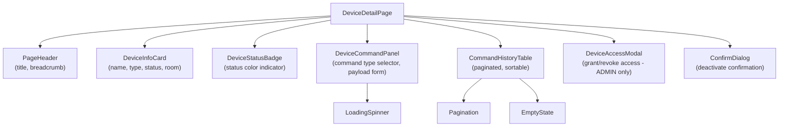

#### AutomationListPage Component Hierarchy

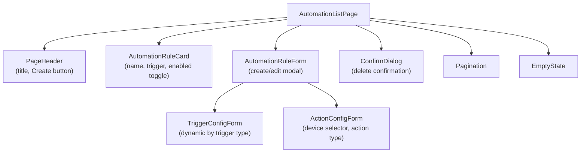

#### Key Component Props and State

| Component | Props | Local State | Responsibility |
|-----------|-------|-------------|----------------|
| LoginForm | onSuccess: () => void | isLoading, error | Renders login form, calls authService.login, handles errors |
| DeviceTable | devices: DeviceResponse[], onCommand, onEdit, onDeactivate | selectedDevice | Renders paginated device list with action buttons |
| DeviceCommandPanel | deviceId: string, deviceType: DeviceType | commandType, payload, isSubmitting | Renders command form, validates compatibility, submits command |
| AutomationRuleForm | rule?: AutomationRuleResponse, onSave, onCancel | formData, actions[] | Full CRUD form for automation rules with dynamic action list |
| TriggerConfigForm | triggerType: TriggerType, onChange | config object | Renders trigger-specific config fields (schedule cron, device state condition) |
| TelemetryChart | deviceId: string, from: Date, to: Date | chartData, isLoading | Fetches and renders time-series chart using recharts library |
| ConfirmDialog | isOpen, title, message, onConfirm, onCancel | — | Reusable confirmation modal |

**Note:** `recharts` library added for TelemetryChart (US-008 requires telemetry visualization).

### 7.4 State Management and API Integration

#### State Strategy

- **Server State:** Managed via custom hooks (`useDevices`, `useAutomations`, etc.) wrapping Axios calls with `useState` + `useEffect`. No external server-state library (React Query deferred; not required by stories).
- **Client/Auth State:** Managed via Zustand store (`authStore.ts`) holding `{ user, role, isAuthenticated }`. Chosen for minimal boilerplate over Redux for this scope.
- **Form State:** React Hook Form with Zod resolvers for all create/edit forms.

**Note:** Zustand added as a dependency for lightweight global auth state management.

#### API Client (`apiClient.ts`)

```typescript
// Axios instance with base URL, credentials: 'include' for HttpOnly cookies
// Request interceptor: adds X-Trace-Id header
// Response interceptor: handles 401 → triggers refresh token flow → retries original request
// Response interceptor: handles 403 → redirects to /unauthorized
// Response interceptor: normalizes error responses to ApiError type
```

#### TypeScript Request/Response Types

```typescript
// api.types.ts
export interface PagedResponse<T> {
  content: T[];
  totalElements: number;
  totalPages: number;
  number: number;
  size: number;
}

export interface ApiError {
  timestamp: string;
  status: number;
  errorCode: string;
  message: string;
  path: string;
  traceId: string;
  fieldErrors: FieldError[];
}

export interface FieldError {
  field: string;
  rejectedValue: unknown;
  message: string;
}

// device.types.ts
export type DeviceType = 'LIGHT' | 'THERMOSTAT' | 'LOCK' | 'SENSOR' | 'SWITCH' | 'CAMERA';
export type DeviceStatus = 'ONLINE' | 'OFFLINE' | 'ERROR' | 'MAINTENANCE';

export interface DeviceResponse {
  id: string;
  name: string;
  deviceType: DeviceType;
  status: DeviceStatus;
  manufacturer?: string;
  modelNumber?: string;
  firmwareVersion?: string;
  attributes: Record<string, unknown>;
  roomId?: string;
  roomName?: string;
  assignedUserId?: string;
  version: number;
  isActive: boolean;
  lastSeenAt?: string;
  createdAt: string;
  updatedAt: string;
}
```

#### Loading / Error / Empty State Handling

- **Loading:** `LoadingSpinner` component shown while `isLoading === true`.
- **Error:** `ErrorBoundary` wraps page-level components; inline error messages shown for form submissions.
- **Empty State:** `EmptyState` component with contextual message and CTA button for list pages.
- **Optimistic Lock Conflict (409):** Displays toast notification: "This record was updated by another user. Please refresh and try again."

#### Auth Token Handling

- Access token stored in HttpOnly cookie (set by server); not accessible via JavaScript.
- Refresh token stored in separate HttpOnly cookie.
- `apiClient.ts` response interceptor detects 401, calls `/api/v1/auth/refresh` once, retries original request.
- On refresh failure, clears `authStore` and redirects to `/login`.

### 7.5 UX Rules

| Rule | Description | Related US |
|------|-------------|------------|
| Validation messages | Inline field-level error messages shown on blur and on submit; mirror backend validation rules | US-001 to US-010 |
| Confirmation dialogs | Required for: deactivate user, deactivate device, delete room, delete automation rule | US-002, US-003, US-004, US-010 |
| Accessibility | WCAG 2.1 AA: all form inputs have associated labels; color is not the only status indicator (text + icon); keyboard navigation supported; ARIA roles on modals | All US |
| Responsive behavior | Fluid layout; tables collapse to card view on mobile (< 768px); sidebar collapses to hamburger menu | All US |
| Status indicators | DeviceStatusBadge uses color + text label (ONLINE=green, OFFLINE=gray, ERROR=red, MAINTENANCE=yellow) | US-004, US-005 |
| Pagination | All list pages show page size selector (10/20/50) and page navigation | All list US |
| Toast notifications | Success and error toasts for all create/update/delete/command operations; auto-dismiss after 5 seconds | All US |

---

## 8. Sequence Diagrams

### Flow 1: User Login (US-001)

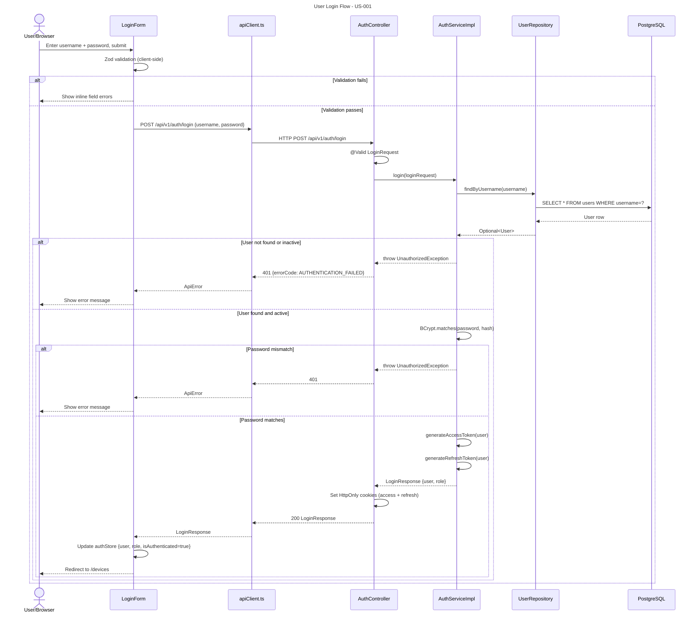

### Flow 2: Register Device (US-003, US-004)

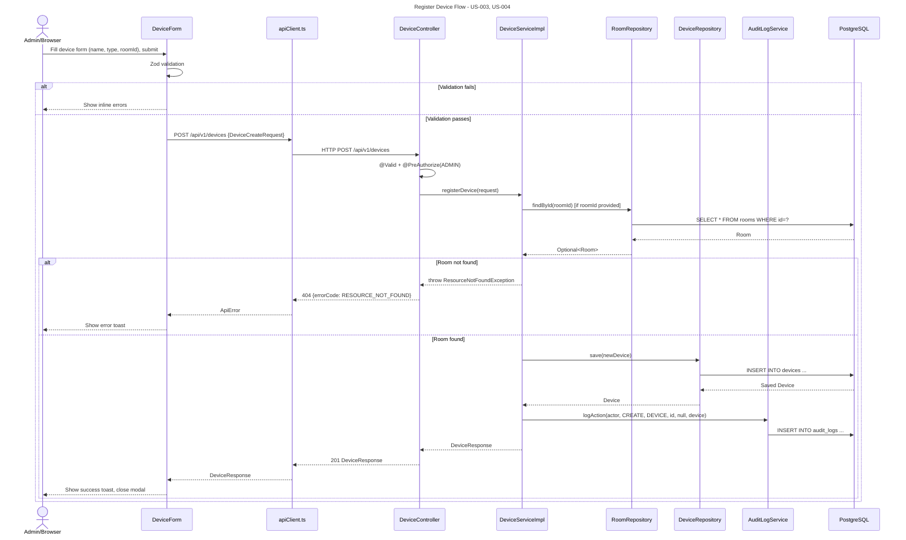

### Flow 3: Issue Device Command (US-006)

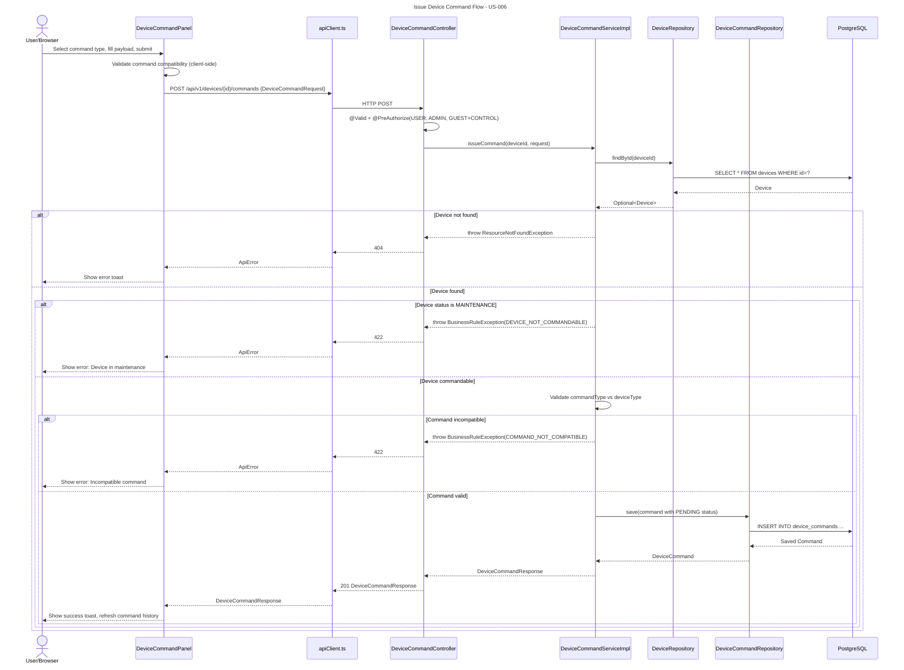

### Flow 4: Ingest Telemetry (US-007)

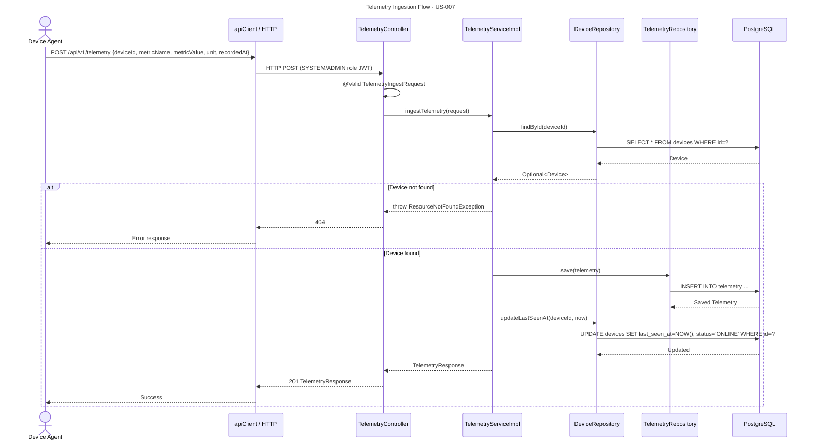

### Flow 5: Create Automation Rule (US-009)

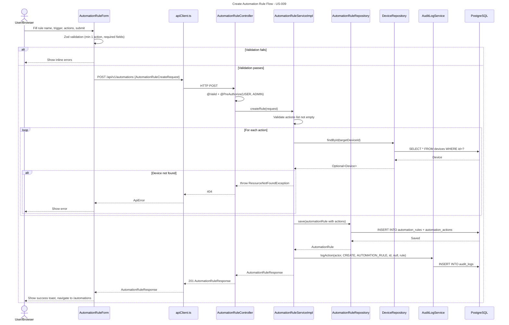

### Flow 6: Manual Automation Trigger (US-010)

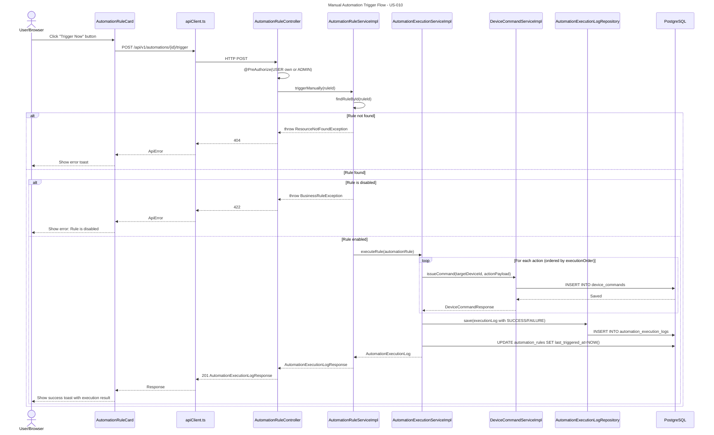

### Flow 7: View Audit Logs (US-011)

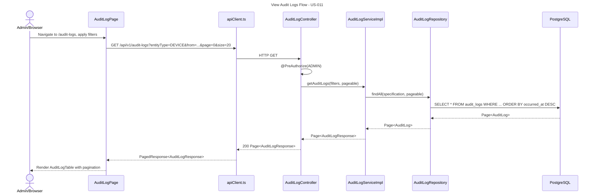

### Flow 8: Grant Device Access to Guest (US-005)

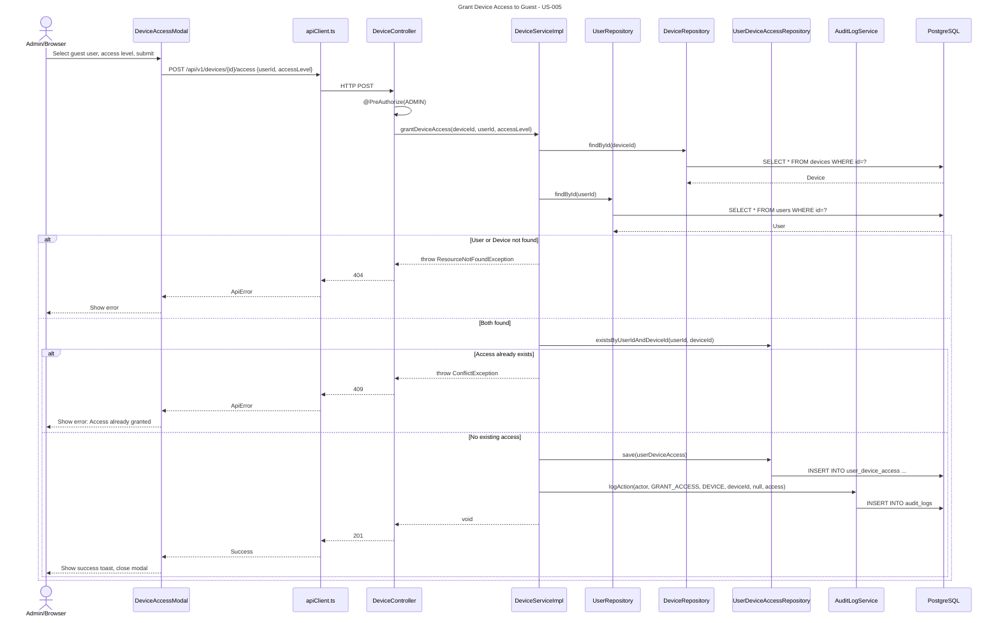

---

## 9. Security Design

### Authentication and Authorization

- **Mechanism:** Stateless JWT authentication via Spring Security.
- **Access Token:** HS256 signed JWT, 15-minute expiry, stored in `HttpOnly; Secure; SameSite=Strict` cookie named `ha_access_token`.
- **Refresh Token:** Separate HttpOnly cookie `ha_refresh_token`, 7-day expiry, rotated on each use.
- **Token Claims:** `sub` (username), `role`, `userId`, `iat`, `exp`.
- **Secret:** Stored in environment variable `JWT_SECRET` (min 256-bit key); never in source code.

### Role-Permission Matrix

| Resource / Action | ADMIN | USER | GUEST |
|-------------------|-------|------|-------|
| Create User | ✅ | ❌ | ❌ |
| View All Users | ✅ | ❌ (own only) | ❌ |
| Deactivate User | ✅ | ❌ | ❌ |
| Create/Delete Room | ✅ | ❌ | ❌ |
| View Rooms | ✅ | ✅ | ✅ |
| Register Device | ✅ | ❌ | ❌ |
| View All Devices | ✅ | ✅ (assigned) | ✅ (granted) |
| Update Device | ✅ | ✅ (assigned) | ❌ |
| Deactivate Device | ✅ | ❌ | ❌ |
| Issue Command | ✅ | ✅ (assigned) | ✅ (CONTROL access) |
| Ingest Telemetry | ✅ | ❌ | ❌ |
| View Telemetry | ✅ | ✅ (assigned) | ❌ |
| Create Automation | ✅ | ✅ | ❌ |
| View Own Automations | ✅ | ✅ (own) | ❌ |
| Delete Automation | ✅ | ✅ (own) | ❌ |
| Grant Device Access | ✅ | ❌ | ❌ |
| View Audit Logs | ✅ | ❌ | ❌ |

### Spring Security Configuration

- `SecurityConfig` defines `SecurityFilterChain` with:
  - Stateless session management (`SessionCreationPolicy.STATELESS`)
  - `JwtAuthenticationFilter` added before `UsernamePasswordAuthenticationFilter`
  - Public paths: `/api/v1/auth/**`, `/actuator/health`, `/v3/api-docs/**`, `/swagger-ui/**`
  - All other paths require authentication
  - Method-level security via `@PreAuthorize` annotations on service/controller methods

### CORS Configuration

- Allowed origins: configured via `CORS_ALLOWED_ORIGINS` environment variable (e.g., `https://app.ha-dxl.com`)
- Allowed methods: GET, POST, PUT, PATCH, DELETE, OPTIONS
- Allowed headers: Content-Type, Authorization, X-Trace-Id
- Allow credentials: true (required for HttpOnly cookies)
- Max age: 3600 seconds

### CSRF

- CSRF protection **disabled** for the REST API (stateless JWT in HttpOnly cookies with `SameSite=Strict` provides equivalent protection; standard REST API pattern).

### Password Handling

- BCrypt with strength 12 (`BCryptPasswordEncoder(12)`).
- Passwords never logged, never returned in API responses.
- `password_hash` column excluded from all DTO mappings via `@JsonIgnore` / MapStruct `@Mapping(ignore=true)`.

### Input Sanitization

- All string inputs validated via Bean Validation (`@Size`, `@Pattern`, `@NotBlank`).
- JSONB fields (attributes, payloads) validated for structure in service layer.
- SQL injection prevented by JPA parameterized queries (no native SQL string concatenation).
- XSS prevention: API returns `Content-Type: application/json`; no HTML rendering server-side.

### Rate Limiting

- Login endpoint (`/api/v1/auth/login`): 10 requests per minute per IP (implemented via Spring's `HandlerInterceptor` with in-memory counter; design default). Bucket4j library added if this is confirmed as a hard requirement.

### OWASP Top 10 Mitigations

| Risk | Mitigation |
|------|------------|
| A01 Broken Access Control | @PreAuthorize on all endpoints; role checks in service layer |
| A02 Cryptographic Failures | BCrypt for passwords; HTTPS enforced; JWT signed with strong secret |
| A03 Injection | JPA parameterized queries; Bean Validation on all inputs |
| A04 Insecure Design | Layered architecture; business rules in service layer; audit logging |
| A05 Security Misconfiguration | Externalized config; no default credentials; Actuator secured |
| A06 Vulnerable Components | Maven dependency management; regular updates |
| A07 Auth Failures | HttpOnly cookies; token rotation; account deactivation |
| A08 Software Integrity | Maven build; Flyway migration checksums |
| A09 Logging Failures | Structured JSON logging; audit log for all state changes; no PII in logs |
| A10 SSRF | No outbound HTTP calls from server in current scope |

### PII and Sensitive Data

- Email addresses masked in logs: `user@***` format.
- Passwords never logged.
- `before_state` / `after_state` in audit logs exclude `password_hash` field.
- All data in transit encrypted via TLS 1.2+ (HTTPS enforced at infrastructure level).

---

## 10. Non-Functional Requirements and Design Response

| NFR | Target | Source | Design Approach |
|-----|--------|--------|------------------|
| Response Time (read) | < 300ms p95 | Design Default | Indexed queries; pagination to limit result sets; N+1 avoided via `@EntityGraph` / JOIN FETCH |
| Response Time (write) | < 500ms p95 | Design Default | Transactional writes; async audit logging via `@Async` |
| Pagination | Max 100 records per page | Design Default | Spring Pageable enforced in all list endpoints; `@Max(100)` on size param |
| N+1 Prevention | Zero N+1 queries | Design Default | `@EntityGraph` on Device (room, assignedUser); `@BatchSize` on collections |
| Scalability | Horizontal scale-ready | Design Default | Stateless JWT; no server-side session; HikariCP connection pool (max 20, design default) |
| Connection Pooling | HikariCP max 20 | Design Default | `spring.datasource.hikari.maximum-pool-size=20` |
| Availability | 99.9% uptime | Design Default | Spring Actuator `/actuator/health` for load balancer health checks; graceful shutdown (`server.shutdown=graceful`) |
| Graceful Failure | No data corruption on crash | Design Default | `@Transactional` boundaries; optimistic locking on Device and AutomationRule |
| Security | OWASP Top 10 | Design Default | See Section 9 |
| Structured Logging | JSON format with traceId | Design Default | Logback with `logstash-logback-encoder`; MDC for `traceId`, `userId`, `requestPath` |
| Correlation/Trace ID | Per-request traceId | Design Default | UUID generated in `JwtAuthenticationFilter`; added to MDC and response header `X-Trace-Id` |
| Actuator Metrics | Exposed for monitoring | Design Default | `spring-boot-actuator` with Micrometer; `/actuator/metrics`, `/actuator/health` |
| Audit Logging | All state changes logged | US-011 | `AuditLogService.logAction()` called in all service write methods |
| Maintainability | Modular, testable code | Design Default | SOLID principles; MapStruct DTOs; interface-based services; no business logic in controllers |
| Data Integrity | No orphaned records | Design Default | FK constraints with appropriate ON DELETE behaviors; optimistic locking |
| Optimistic Locking | Concurrent update protection | Design Default | `@Version` on Device, AutomationRule; 409 response on conflict |
| Telemetry Retention | 90 days | Design Default | `@Scheduled(cron="0 0 2 * * *")` purge job in `TelemetryServiceImpl` |
| Compliance/Privacy | PII protection | Design Default | Email masking in logs; passwords excluded from all responses and audit states |
| Accessibility | WCAG 2.1 AA | Design Default | Labeled inputs; non-color status indicators; keyboard navigation; ARIA roles |
| Browser Support | Chrome 120+, Firefox 120+, Safari 17+, Edge 120+ | Design Default | React 18 + Vite; no IE11 support |
| Config Management | No secrets in code | Design Default | `application.yml` uses `${ENV_VAR}` placeholders; `.env` excluded from VCS |
| Deployment | Containerized | Design Default | `Dockerfile` with multi-stage build; `docker-compose.yml` for local dev |
| DB Migration on Startup | Flyway auto-run | Design Default | `spring.flyway.enabled=true`; `spring.flyway.locations=classpath:db/migration` |

---

## 11. Testing Strategy

### Unit Tests (JUnit 5 + Mockito)

| Layer | What to Test | Key Classes |
|-------|-------------|-------------|
| Service | Business logic, validations, exception paths | UserServiceImpl, DeviceServiceImpl, AutomationRuleServiceImpl, TelemetryServiceImpl |
| Mapper | DTO ↔ Entity mapping correctness | UserMapper, DeviceMapper, AutomationRuleMapper |
| Validators | Custom Bean Validation annotations | CommandTypeCompatibilityValidator |
| TriggerEvaluator | Each Strategy implementation | ScheduleTriggerEvaluator, DeviceStateTriggerEvaluator, ManualTriggerEvaluator |
| JwtTokenProvider | Token generation, validation, expiry | JwtTokenProvider |

**Coverage target:** 80% line coverage on service and mapper classes (design default).

### Repository / Integration Tests (JUnit 5 + Testcontainers + Spring Data)

| Test | What to Verify |
|------|----------------|
| UserRepositoryTest | findByUsername, findByEmail, unique constraints |
| DeviceRepositoryTest | Filter queries (by room, status, type), pagination |
| TelemetryRepositoryTest | Date-range queries, purge by date |
| AutomationRuleRepositoryTest | Find by owner, find enabled rules |
| AuditLogRepositoryTest | Filter by entity type, actor, date range |

Testcontainers spins up a real PostgreSQL 15 container for all repository tests.

### API / Controller Tests (MockMvc)

| Test | What to Verify |
|------|----------------|
| AuthControllerTest | Login success/failure, token refresh, logout |
| UserControllerTest | CRUD endpoints, role-based access (403 scenarios) |
| DeviceControllerTest | Register, update (optimistic lock conflict), command issuance |
| TelemetryControllerTest | Ingest validation, date-range query |
| AutomationControllerTest | Create with actions, toggle, manual trigger |
| AuditLogControllerTest | Filtered query, ADMIN-only access |

MockMvc with `@SpringBootTest(webEnvironment=RANDOM_PORT)` + Testcontainers for full integration.

### Frontend Tests (React Testing Library + Jest)

| Test | What to Verify |
|------|----------------|
| LoginForm.test.tsx | Renders form, shows validation errors, calls authService on submit |
| DeviceTable.test.tsx | Renders device list, pagination, status badges |
| DeviceCommandPanel.test.tsx | Command type selection, incompatible command warning |
| AutomationRuleForm.test.tsx | Add/remove actions, trigger type config rendering |
| PrivateRoute.test.tsx | Redirects unauthenticated users to /login |
| RoleRoute.test.tsx | Blocks unauthorized roles with 403 page |

### E2E Scope (Deferred)

- E2E tests using Playwright are deferred to a future sprint. Critical happy paths to cover: Login → View Devices → Issue Command → View Audit Log.

### Acceptance Criteria → Test Level Mapping

| Acceptance Criterion | Test Level |
|---------------------|------------|
| User can log in with valid credentials | API Test (AuthControllerTest), Frontend (LoginForm.test) |
| Invalid credentials return 401 | API Test |
| ADMIN can create/deactivate users | API Test (UserControllerTest) |
| Device status transitions correctly | Unit Test (DeviceServiceImpl), Repository Test |
| Command rejected for MAINTENANCE device | Unit Test (DeviceCommandServiceImpl) |
| Telemetry updates device last_seen_at | Unit Test (TelemetryServiceImpl) |
| Automation rule requires at least 1 action | Unit Test, API Test |
| Optimistic lock conflict returns 409 | API Test (DeviceControllerTest) |
| Audit log created on every write operation | Integration Test |
| GUEST cannot access audit logs | API Test (403 scenario) |

---

## 12. Traceability Matrix

| US ID | Story Title | Priority | API IDs | Tables | Backend Classes | Frontend Pages/Components | Sequence Diagram | AC Covered |
|-------|-------------|----------|---------|--------|-----------------|--------------------------|------------------|------------|
| US-001 | User Authentication | High | API-001, API-002, API-003 | users | AuthController, AuthServiceImpl, JwtTokenProvider, UserRepository | LoginPage, LoginForm, authStore | Flow 1: User Login | Y |
| US-002 | User Management | High | API-004 to API-009 | users | UserController, UserServiceImpl, UserRepository, UserMapper | UserListPage, UserDetailPage, UserForm, UserTable, ChangePasswordModal | — | Y |
| US-003 | Room Management | High | API-010 to API-014, API-020 | rooms, devices | RoomController, RoomServiceImpl, RoomRepository, RoomMapper | RoomListPage, RoomCard, RoomForm | Flow 2: Register Device | Y |
| US-004 | Device Registration & Management | High | API-015 to API-019 | devices | DeviceController, DeviceServiceImpl, DeviceRepository, DeviceMapper | DeviceListPage, DeviceDetailPage, DeviceForm, DeviceTable, DeviceStatusBadge | Flow 2: Register Device | Y |
| US-005 | Guest Device Access | Medium | API-021, API-022, API-016 | user_device_access, devices | DeviceController, DeviceServiceImpl, UserDeviceAccessRepository | DeviceDetailPage, DeviceAccessModal, DeviceListPage | Flow 8: Grant Device Access | Y |
| US-006 | Device Command Issuance | High | API-023, API-024 | device_commands, devices | DeviceCommandController, DeviceCommandServiceImpl, DeviceCommandRepository, DeviceCommandMapper | DeviceDetailPage, DeviceCommandPanel, CommandHistoryTable | Flow 3: Issue Device Command | Y |
| US-007 | Telemetry Ingestion | High | API-025, API-026 | telemetry, devices | TelemetryController, TelemetryServiceImpl, TelemetryRepository, TelemetryMapper | TelemetryDashboardPage, TelemetryTable | Flow 4: Ingest Telemetry | Y |
| US-008 | Telemetry Visualization | Medium | API-026 | telemetry | TelemetryController, TelemetryServiceImpl | TelemetryDashboardPage, TelemetryChart | — | Y |
| US-009 | Create Automation Rule | High | API-027, API-028, API-029 | automation_rules, automation_actions | AutomationRuleController, AutomationRuleServiceImpl, AutomationRuleRepository, AutomationActionRepository | AutomationListPage, AutomationDetailPage, AutomationRuleForm, TriggerConfigForm, ActionConfigForm | Flow 5: Create Automation Rule | Y |
| US-010 | Manage Automation Rules | Medium | API-030 to API-034 | automation_rules, automation_actions, automation_execution_logs | AutomationRuleController, AutomationRuleServiceImpl, AutomationExecutionServiceImpl, TriggerEvaluator (Strategy) | AutomationListPage, AutomationDetailPage, AutomationRuleCard, ExecutionLogTable | Flow 6: Manual Automation Trigger | Y |
| US-011 | Audit Log Viewing | Medium | API-035, API-036 | audit_logs | AuditLogController, AuditLogServiceImpl, AuditLogRepository, AuditLogMapper | AuditLogPage, AuditLogTable | Flow 7: View Audit Logs | Y |
| US-012 | Device Status Monitoring | Medium | API-016, API-017, API-026 | devices, telemetry | DeviceController, TelemetryController, DeviceServiceImpl | DeviceListPage, DeviceDetailPage, DeviceStatusBadge, TelemetryDashboardPage | Flow 4: Ingest Telemetry | Y |

---

## 13. Implementation Guidance for Code Generation

### Recommended Build Order

| Phase | Module | Priority | Reason |
|-------|--------|----------|--------|
| 1 | Database schema (Flyway V1–V11) | High | All modules depend on schema |
| 2 | Security config, JWT, User + Auth module | High | All APIs require authentication |
| 3 | Room module | High | Devices depend on rooms |
| 4 | Device module (registration, management) | High | Commands and telemetry depend on devices |
| 5 | Device Command module | High | Core device control feature |
| 6 | Telemetry module | High | Core monitoring feature |
| 7 | Automation module (rules + execution) | High | Depends on devices |
| 8 | Audit Log module | Medium | Cross-cutting; wired into all write services |
| 9 | User Device Access (Guest sharing) | Medium | Depends on users and devices |
| 10 | Frontend: Auth + Layout + Routing | High | Foundation for all pages |
| 11 | Frontend: Device pages + Command panel | High | Core user-facing feature |
| 12 | Frontend: Telemetry dashboard | Medium | Visualization feature |
| 13 | Frontend: Automation pages | High | Core automation feature |
| 14 | Frontend: User management + Audit log | Medium | Admin features |

### Naming Conventions

| Artifact | Convention | Example |
|----------|-----------|--------|
| Java classes | PascalCase | `DeviceServiceImpl` |
| Java methods/fields | camelCase | `getDeviceById`, `deviceType` |
| DTOs | Suffix with Request/Response | `DeviceCreateRequest`, `DeviceResponse` |
| REST endpoints | Plural nouns, kebab-case | `/api/v1/automation-rules` |
| JSON fields | camelCase | `"deviceType"`, `"createdAt"` |
| DB tables | snake_case, plural | `devices`, `automation_rules` |
| DB columns | snake_case | `device_type`, `created_at` |
| DB indexes | `idx_{table}_{column(s)}` | `idx_devices_room_id` |
| Flyway scripts | `V{n}__{description}.sql` | `V3__init_schema_devices.sql` |
| React components | PascalCase | `DeviceCommandPanel` |
| React hooks | camelCase, `use` prefix | `useDevices`, `useAuth` |
| TypeScript types | PascalCase | `DeviceResponse`, `ApiError` |
| Environment variables | UPPER_SNAKE_CASE | `JWT_SECRET`, `DB_URL` |

### Coding Standards

1. **Constructor injection only** — no `@Autowired` on fields; use `@RequiredArgsConstructor` (Lombok).
2. **No entity exposure in APIs** — all controller methods accept/return DTOs; entities never serialized directly.
3. **DTO/Entity separation via MapStruct** — all mappings in `*Mapper` interfaces; no manual `new DTO()` construction in service layer.
4. **No business logic in controllers** — controllers handle HTTP concerns only (validation, response codes, header setting).
5. **Optional handling** — `repository.findById()` always followed by `.orElseThrow(() -> new ResourceNotFoundException(...))`. No `.get()` without check.
6. **Logging rules** — use SLF4J `log.info/warn/error`; include `traceId` from MDC; never log passwords, tokens, or full PII; log at INFO for business events, DEBUG for internal flow.
7. **Transaction boundaries** — `@Transactional` on service implementation methods only; read-only methods use `@Transactional(readOnly=true)`.
8. **Immutable DTOs** — use Lombok `@Value` or Java records for response DTOs where possible.
9. **Enum validation** — custom `@ValidEnum` annotation for string-to-enum validation in request DTOs.
10. **Test naming** — `methodName_scenario_expectedResult()` pattern (e.g., `createUser_whenEmailExists_throwsConflictException`).

### Configuration Keys and Environment Variables

```
# Database
DB_URL                        # JDBC URL for PostgreSQL
DB_USERNAME                   # Database username
DB_PASSWORD                   # Database password
DB_POOL_MAX_SIZE              # HikariCP max pool size

# JWT
JWT_SECRET                    # HS256 signing secret (min 256-bit)
JWT_ACCESS_TOKEN_EXPIRY_MS    # Access token expiry in milliseconds
JWT_REFRESH_TOKEN_EXPIRY_MS   # Refresh token expiry in milliseconds

# CORS
CORS_ALLOWED_ORIGINS          # Comma-separated allowed origins

# Application
SERVER_PORT                   # HTTP server port
SPRING_PROFILES_ACTIVE        # Active Spring profile (dev/staging/prod)

# Telemetry Retention
TELEMETRY_RETENTION_DAYS      # Number of days to retain telemetry (default: 90)

# Logging
LOG_LEVEL_ROOT                # Root log level
LOG_LEVEL_APP                 # Application-specific log level

# Frontend
VITE_API_BASE_URL             # Backend API base URL for React app
```

### Definition of Done Checklist

- [ ] All acceptance criteria for the related US are implemented and verifiable.
- [ ] Unit tests written with ≥ 80% line coverage on service and mapper classes.
- [ ] Repository integration tests pass with Testcontainers.
- [ ] API tests (MockMvc) cover success path, validation failure (400), unauthorized (401), forbidden (403), and not found (404) scenarios.
- [ ] All new endpoints documented in springdoc-openapi (`@Operation`, `@ApiResponse` annotations).
- [ ] No entity classes returned directly from controllers (DTO pattern enforced).
- [ ] No hardcoded secrets or credentials in source code.
- [ ] Flyway migration script created for any schema change.
- [ ] Audit logging implemented for all write operations.
- [ ] `@Transactional` applied correctly; no missing transaction boundaries.
- [ ] All Mermaid diagrams in this document updated if design changes are made.
- [ ] Code reviewed and approved by at least one peer.
- [ ] No SonarQube critical or blocker issues.
- [ ] Frontend component has corresponding React Testing Library test.
- [ ] Accessibility: all form inputs have labels; no WCAG 2.1 AA violations in new components.
